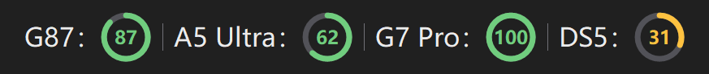
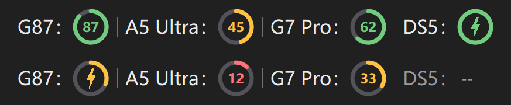
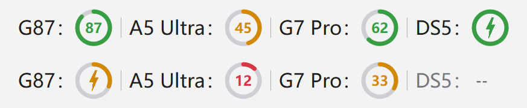
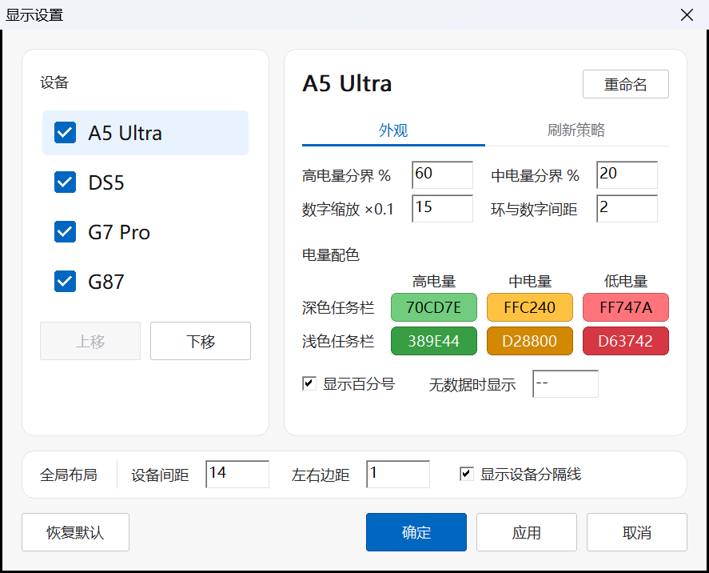

# PeripheralBattery

TrafficMonitor 插件：在任务栏显示无线键盘、鼠标、手柄的剩余电量。



## 支持设备

| 设备 | 通道 | 电量来源 | 刷新策略 |
| --- | --- | --- | --- |
| 迈从（MCHOSE）G87 2.4G 键盘 | HID `VID_41E4`，0x13 协议帧 | 响应 `[5]`，充电位 `[6] & 0x10` | 闲置后再操作时查一次，使用中每 5 秒一次，闲置即停并保留最后读数 |
| 迈从（MCHOSE）A5 Ultra 2.4G 鼠标 | HID `VID_3837 / PID_100C`，UsagePage `0xFF01` | `GetFeature(0x11)` 的 `[11]`，充电位 `[12]` | 同上 |
| 盖世小鸡（GameSir）G7 Pro 手柄 | `\\.\XboxGIP` 总线，只读旁观 | Status 消息，低 2 位为 4 档，bit4 为充电 | 不发查询；90 秒无消息视为断开 |
| PS5 DualSense 手柄 | USB HID `VID_054C / PID_0CE6`（需 [DS5Dongle](https://github.com/awalol/DS5Dongle) 桥接） | Input Report `0x01` 的 `byte[53]`，低 4 位档位 0~10，高 4 位充电状态 | 每 2 秒枚举在位状态，在位时每 60 秒读一次 |
| 罗技（Logitech）2.4G 鼠标 | 接收器 `VID_046D`，HID++ 2.0 `BATTERY_VOLTAGE` | 电压毫伏；采样点在内部二极管后，显示时补 0.15 V | 每 2 秒查一次；鼠标休眠时接收器不回包，保留上次读数 |

G7 Pro 只有 4 档，精确值走未公开的私有协议。罗技只报电压，设置里可选显示电压或电量环（百分比）；分界分别按毫伏和百分比调。

## 显示

圆环按电量描弧，数字在环内。默认 ≥60% 绿、20~59% 黄、<20% 红；充电时换成 ⚡；未连接则不画环、`--` 置灰。跟随深色 / 浅色任务栏与系统字体缩放。




## 设置

参数按设备独立可自定义。



## 安装

从 [Releases](https://github.com/hexiosr/PeripheralBatteryForTM/releases/latest) 下载 `PeripheralBattery.dll`，放入 TrafficMonitor 的 `plugins` 目录，重启。

## 构建

```
build.bat          :: Visual Studio + Windows SDK
build-mingw.bat    :: MinGW-w64
```

## License

MIT
